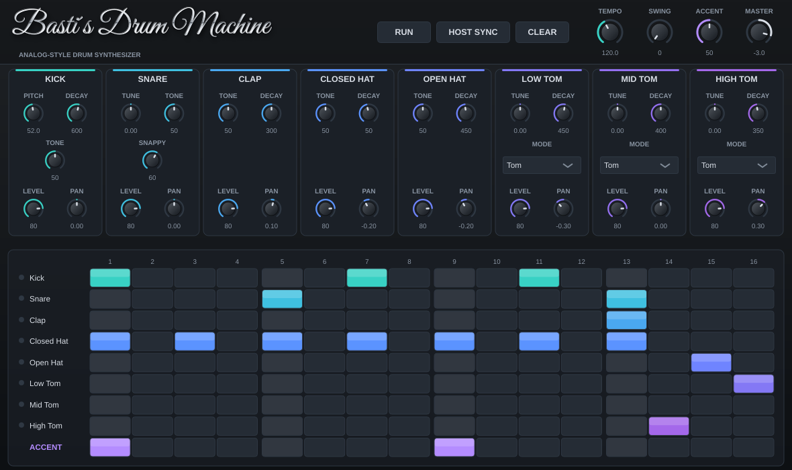

# Bastis Drumcomputer

Analog-Style Drum Synthesizer als VST3 und Standalone für Windows und macOS (JUCE 8, CMake).
Alle Klänge entstehen per DSP-Synthese, es werden keine Samples verwendet.



## Dateistruktur

```
BastisDrumcomputer/
├── CMakeLists.txt              Build (JUCE 8.0.9 per FetchContent oder lokal per -DJUCE_DIR)
├── Resources/Fonts/            Schreibschrift fürs Logo (Great Vibes, SIL Open Font License)
├── Docs/                       Screenshot + Hörbeispiel des Start-Patterns
├── Installer/                  Windows-Setup (Inno-Setup-Skript + build-windows.bat)
├── .github/workflows/          Automatischer Windows-Build der Setup-Datei auf GitHub
└── Source/
    ├── PluginProcessor.h/.cpp  AudioProcessor: MIDI, Sequenzer, Engine, State speichern/laden
    ├── PluginEditor.h/.cpp     Hauptfenster (Logo, Transport, Kanalzüge, Step-Raster)
    ├── Parameters.h/.cpp       Alle APVTS-Parameter (IDs, Bereiche, Defaults)
    ├── DSP/
    │   ├── DspHelpers.h        Rauschen, Hüllkurven, SVF-Filter, PolyBLEP-Rechteck
    │   ├── DrumVoices.h        Kick, Snare, Hi-Hat, Clap, Tom/Conga (reine Synthese)
    │   ├── DrumEngine.h/.cpp   Stimmenverwaltung, sample-genaue Trigger, Mixer, GM-Map
    │   └── Sequencer.h/.cpp    16-Step-Pattern (lock-free) + Sequenzer mit Accent/Swing
    └── UI/
        ├── DrumLookAndFeel.*   Farben, Regler- und Button-Design
        ├── LogoComponent.*     "Basti´s Drum Machine" in Metall-Schreibschrift
        ├── InstrumentStrip.*   Kanalzug pro Instrument
        └── StepGrid.*          16-Step-Raster inkl. Accent-Zeile und Lauflicht
```

## Bauen

Voraussetzungen: CMake ≥ 3.22, Git, und auf Windows Visual Studio 2022 (C++), auf dem Mac Xcode.
JUCE wird beim ersten Konfigurieren automatisch heruntergeladen.

**Windows**
```
cmake -B build -G "Visual Studio 17 2022"
cmake --build build --config Release
```

**macOS** (Universal Binary arm64 + x86_64, ab macOS 12)

Mit der Xcode-App:
```
cmake -B build -G Xcode
cmake --build build --config Release
```

Ohne Xcode-App, nur mit den Command Line Tools (`xcode-select --install`) und CMake (z.B. `brew install cmake`):
```
cmake -B build -DCMAKE_BUILD_TYPE=Release
cmake --build build -j8
```

Wichtig: Nach Änderungen an der CMakeLists.txt den alten `build`-Ordner löschen (`rm -rf build`) und neu konfigurieren, sonst bleiben alte Einstellungen im CMake-Cache hängen.

Die Ergebnisse liegen unter `build/BastisDrumcomputer_artefacts/Release/VST3` und `.../Standalone`.
Mit `-DBASTI_COPY_PLUGIN_AFTER_BUILD=ON` wird das VST3 nach dem Build direkt in den System-Plugin-Ordner kopiert.
Wenn du schon eine JUCE-Kopie hast: `-DJUCE_DIR=/pfad/zu/JUCE`.

## Windows-Installer (Setup-Datei für Endnutzer)

Endnutzer bekommen eine einzige Datei `BastisDrumcomputer-Setup-<Version>.exe`. Doppelklick, "Weiter" klicken, fertig:
das VST3 landet in `C:\Program Files\Common Files\VST3` (dort sucht jede DAW automatisch), die Standalone-App
unter `C:\Program Files\Basti\Bastis Drumcomputer` mit Startmenü-Eintrag (Desktop-Verknüpfung optional).
Deinstallieren geht normal über "Apps & Features".

Die Setup-Datei lässt sich auf zwei Wegen erzeugen:

**A) Automatisch über GitHub (kein Windows-PC nötig)**
1. Den Projektordner als GitHub-Repository hochladen (inkl. des versteckten Ordners `.github`).
2. Unter "Actions" läuft "Windows-Installer" bei jedem Push automatisch (oder per "Run workflow").
3. Nach ca. 10 bis 15 Minuten die Setup-Datei im Lauf unter "Artifacts" herunterladen.
4. Zum Weitergeben: Jeder Build auf `main` legt die Setup-Datei zusätzlich öffentlich im GitHub-Release `v<Version>` ab
   (Seite "Releases" im Repository). Für eine neue Version die Versionsnummer in der CMakeLists.txt erhöhen.

**B) Auf einem Windows-PC**
1. Visual Studio 2022 (Workload "Desktopentwicklung mit C++"), CMake, Git und [Inno Setup 6](https://jrsoftware.org/isdl.php) installieren.
2. `Installer\build-windows.bat` doppelklicken.
3. Die Setup-Datei liegt danach in `Installer\Output\`.

Die Version kommt aus `project(... VERSION x.y.z)` in der CMakeLists.txt (beim GitHub-Build automatisch).
Lokal: `ISCC.exe /DAppVersion=0.2.0 Installer\BastisDrumcomputer.iss`.

Hinweis: Die Setup-Datei ist nicht digital signiert. Windows zeigt deshalb beim ersten Start eine SmartScreen-Warnung
("Der Computer wurde durch Windows geschützt"). Nutzer klicken auf "Weitere Informationen" und dann "Trotzdem ausführen".
Wegbekommen lässt sich das nur mit einem Code-Signing-Zertifikat.

## Klangerzeugung

| Instrument | Synthese | Regler |
|---|---|---|
| Kick | Sinus mit schneller Pitch-Hüllkurve (Sweep), exponentieller Decay, Klick-Transient durch Tone-Tiefpass, sanfte Sättigung bei Accent | Pitch, Decay, Tone |
| Snare | Zwei gestimmte Sinus-Körper (185/330 Hz) mit leichtem Pitch-Drop + hochpassgefiltertes Rauschen | Tune, Tone, Snappy |
| Clap | 4 Rausch-Bursts im Abstand von ca. 10 ms durch einen Bandpass, danach eine abklingende Rauschfahne | Tone, Decay |
| Closed/Open Hat | 6 frei laufende, verstimmte Rechteck-Oszillatoren (PolyBLEP, Schmitt-Trigger-Netzwerk-Emulation) → 2 Bandpässe → Hochpass → VCA. Closed Hat würgt die Open Hat ab | Tone, Decay |
| Low/Mid/High Tom | Gedämpfter Resonator (rotierender Zeiger, per Impuls angestoßen) mit Pitch-Abfall, im Tom-Modus mit etwas Rauschen. Umschaltbar auf Conga (höher, kürzer, klarer) | Tune, Decay, Mode |

Jedes Instrument hat zusätzlich Level und Pan. Jede Stimme ist für sich monophon wie bei Hardware-Drumcomputern, alle Stimmen klingen gleichzeitig.

## MIDI (GM-Drum-Map, C1 = Note 36)

| Note | Instrument |
|---|---|
| 35, 36 (C1) | Kick |
| 37, 38 (D1), 40 | Snare |
| 39 (D#1) | Clap |
| 42 (F#1), 44 | Closed Hat |
| 46 (A#1) | Open Hat |
| 41, 43, 45 | Low Tom |
| 47, 48 | Mid Tom |
| 50 | High Tom |
| 64 / 63 / 62 | Low / Mid / High Conga (Tom-Stimmen im Conga-Modus) |

Velocity steuert die Lautstärke, ab Velocity 120 kommt zusätzlich der Accent dazu.

## Sequenzer

- 16 Steps (Sechzehntel), eine Zeile pro Instrument plus eine globale Accent-Zeile.
- Klick schaltet einen Step, Ziehen malt mehrere Steps, Klick auf einen Instrumentnamen spielt den Sound an.
- **Host Sync an:** Der Sequenzer folgt Tempo und Transport der DAW.
- **Run:** Interner Takt mit eigenem Tempo, z.B. im Standalone-Modus oder wenn die DAW steht.
- Swing verzögert jede zweite Sechzehntel, Accent bestimmt, wie stark betonte Steps hervorstechen.
- Das Pattern wird mit dem DAW-Projekt gespeichert.

Alle Regler sind über das APVTS als DAW-Parameter automatisierbar (Gruppen: Master, Sequencer, je Instrument).

## Branding und Rechtliches

- Produktname "Bastis Drumcomputer", Hersteller "Basti", Beschreibung "Analog-Style Drum Synthesizer".
- Im Code und in der GUI kommen keine geschützten Modell- oder Herstellernamen vor. Das Farbschema (Graphit mit Türkis bis Violett) lehnt sich bewusst an kein Hardware-Gehäuse an.
- Die Logo-Schrift "Great Vibes" steht unter der SIL Open Font License (siehe `Resources/Fonts/OFL-GreatVibes.txt`) und darf eingebettet werden. Um sie zu ersetzen, eine andere `.ttf` oder `.otf` in `Resources/Fonts/` legen. Ohne Schriftdatei nutzt das Logo eine System-Schreibschrift.
- Vor dem Vertrieb: Plugin-Codes `Bsti`/`Bdc1` in der CMakeLists.txt beibehalten oder anpassen und für VST3 die Steinberg-Lizenzbedingungen beachten.
